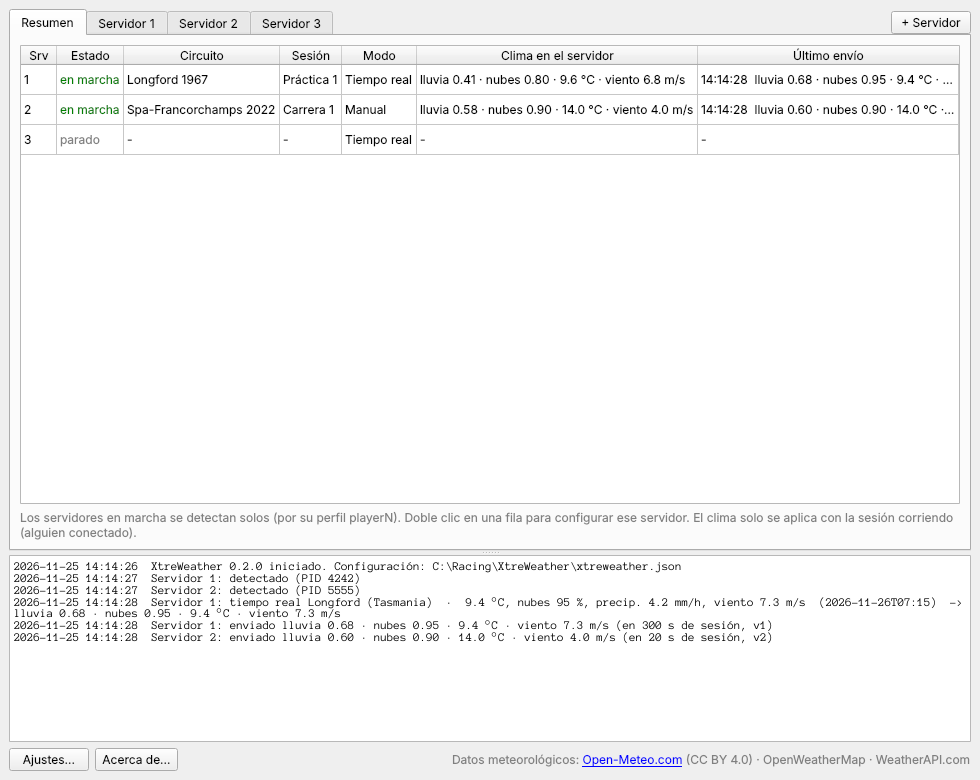

# XtreWeather

**Clima en tiempo real para servidores dedicados de rFactor 2.** · [Read in English](README.md)

XtreWeather consulta el tiempo real en la ubicación de cada circuito y se lo envía a tus servidores dedicados de rFactor 2 a través de [rF2SharedMemoryMapPlugin](https://github.com/TheIronWolfModding/rF2SharedMemoryMapPlugin): lluvia, nubes, temperatura y viento, aplicados en directo mientras la sesión está en marcha.

## Características

- **Varios servidores** en la misma máquina, detectados solos (por su `+profile=playerN`), cada uno con su configuración.
- **Tiempo real** desde Open-Meteo (gratis, sin clave), OpenWeatherMap o WeatherAPI (clave gratuita).
- **Modo manual** para fijar lluvia, nubes, temperatura y viento, o **desactivado** para no tocar un servidor.
- Coordenadas **según el circuito cargado** (tabla editable con buscador de lugares) o fijas.
- Transiciones suaves, clima inmediato al empezar cada sesión y envíos en espera hasta que la sesión arranca.
- Adelanto de pronóstico, ajuste de temperatura y multiplicador de lluvia.
- Un solo `.exe`, sin instalador. Bandeja del sistema, arranque con Windows y registro de actividad.
- Español e inglés.

## Inicio rápido

1. Instala **rF2SharedMemoryMapPlugin64** en cada servidor y pon `"EnableWeatherControlInput":1` y `"UnsubscribedBuffersMask":32` en su `CustomPluginVariables.JSON`.
2. Descarga `XtreWeather.exe` de **Releases**, déjalo en su propia carpeta y ábrelo en la máquina de los servidores.
3. Entra en un servidor: el clima se aplica en cuanto la sesión está en marcha.

Guía completa: **[docs/MANUAL.es.md](docs/MANUAL.es.md)**

## Compilar

Windows, Python 3.10+: ejecuta `build.bat` (instala `requirements.txt` y genera `XtreWeather.exe` con PyInstaller). O ejecútalo directamente con `python xtreweather.py`.

## Créditos

- Creado por **v1ct0r** para la comunidad **Xtresimracing**.
- **Este proyecto se ha creado con asistencia de IA** (Claude, de Anthropic).
- [rF2SharedMemoryMapPlugin](https://github.com/TheIronWolfModding/rF2SharedMemoryMapPlugin) de The Iron Wolf.
- Datos meteorológicos de [Open-Meteo.com](https://open-meteo.com/) (CC BY 4.0), OpenWeatherMap y WeatherAPI.com.

## Licencia

[GNU GPL v3](LICENSE). Sin garantía. Sin relación con Studio 397 ni Motorsport Games.
