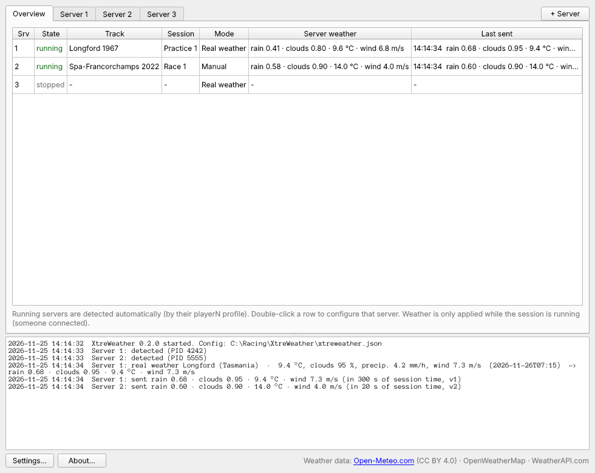

# XtreWeather

**Real-time weather for rFactor 2 dedicated servers.** · [Leer en español](README.es.md)

XtreWeather fetches the real weather at each track's location and sends it to your rFactor 2 dedicated servers through [rF2SharedMemoryMapPlugin](https://github.com/TheIronWolfModding/rF2SharedMemoryMapPlugin): rain, clouds, temperature and wind, applied live while the session is running.

## Features

- **Multiple servers** on the same machine, detected automatically (by their `+profile=playerN`), each with its own settings.
- **Real weather** from Open-Meteo (free, no key), OpenWeatherMap or WeatherAPI (free API key).
- **Manual mode** to set rain, clouds, temperature and wind yourself, or **disabled** to leave a server alone.
- Coordinates **from the loaded track** (editable table with place search) or fixed.
- Smooth transitions, instant weather when a new session starts, sends queued until the session is running.
- Forecast offset, temperature offset and rain multiplier.
- Single `.exe`, no installer. System tray, start with Windows, activity log.
- English and Spanish.

## Quick start

1. Install **rF2SharedMemoryMapPlugin64** on every server and set `"EnableWeatherControlInput":1` and `"UnsubscribedBuffersMask":32` in its `CustomPluginVariables.JSON`.
2. Download `XtreWeather.exe` from **Releases**, put it in its own folder and run it on the server machine.
3. Join a server: the weather is applied once the session is running.

Full guide: **[docs/MANUAL.en.md](docs/MANUAL.en.md)**

## Building

Windows, Python 3.10+: run `build.bat` (installs `requirements.txt` and builds `XtreWeather.exe` with PyInstaller). Or run directly with `python xtreweather.py`.

## Credits

- Created by **v1ct0r** for the **Xtresimracing** community.
- **This project was created with AI assistance** (Claude, by Anthropic).
- [rF2SharedMemoryMapPlugin](https://github.com/TheIronWolfModding/rF2SharedMemoryMapPlugin) by The Iron Wolf.
- Weather data by [Open-Meteo.com](https://open-meteo.com/) (CC BY 4.0), OpenWeatherMap and WeatherAPI.com.

## Licence

[GNU GPL v3](LICENSE). No warranty. Not affiliated with Studio 397 or Motorsport Games.
