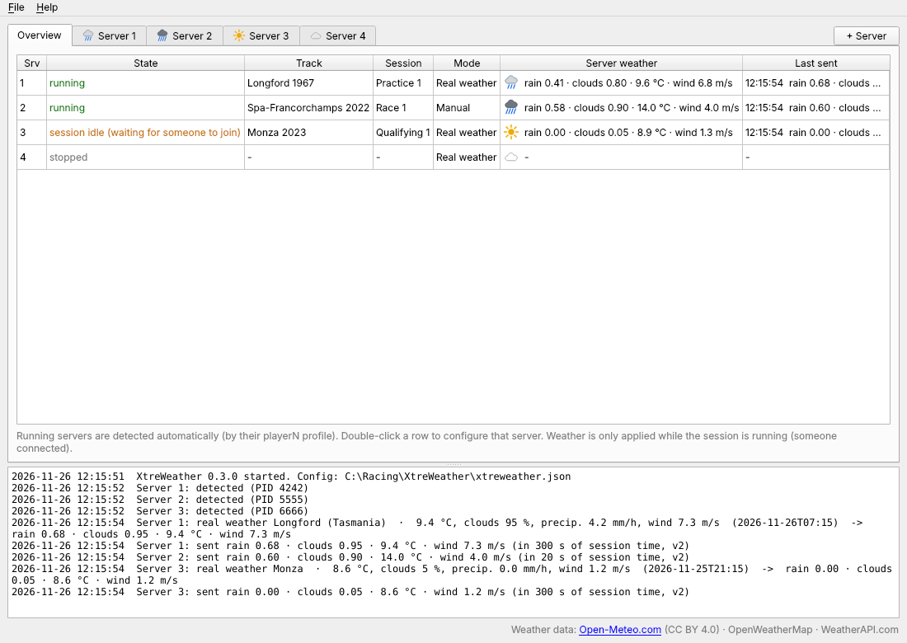
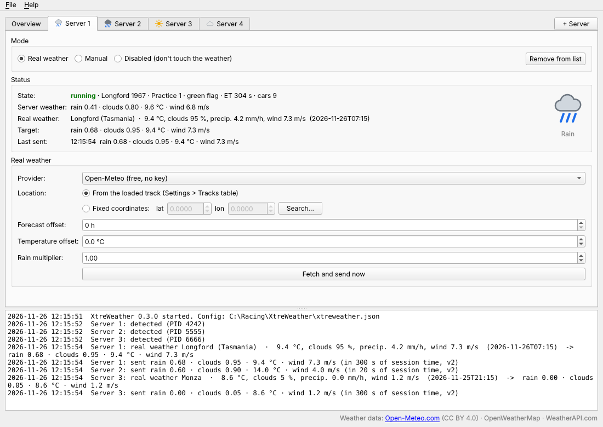
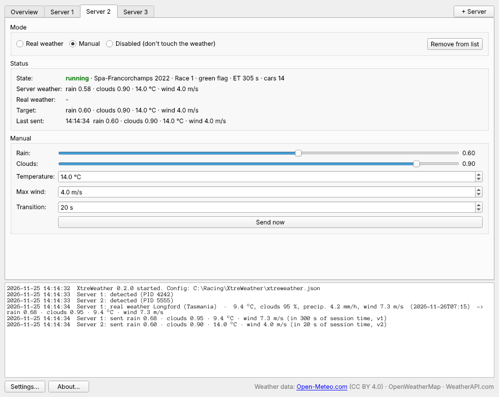
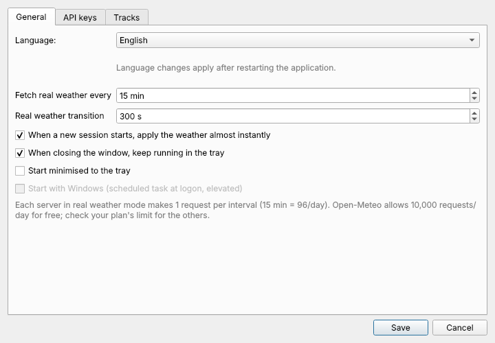
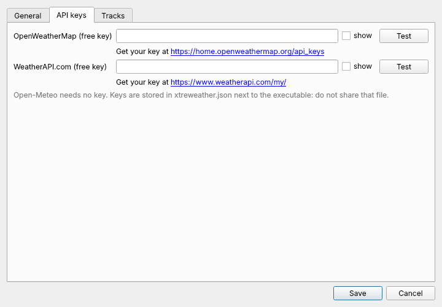
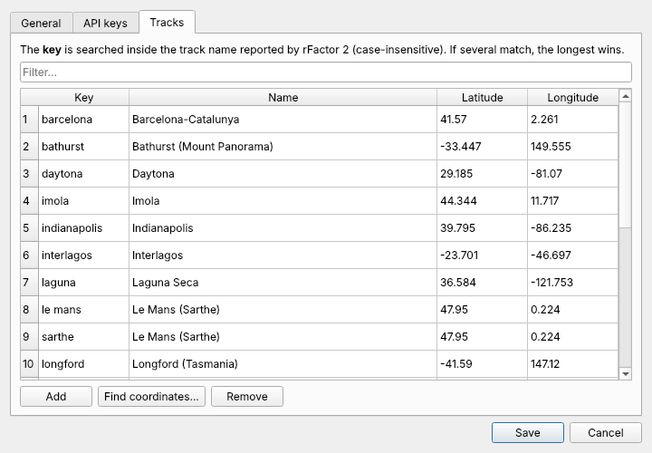

# XtreWeather manual

**XtreWeather** brings the track's real weather to your **rFactor 2** dedicated servers: it queries a weather service, converts the data into rF2 rain, clouds, temperature and wind, and sends it to each server while the session is running. You can also set the weather manually.

> Created by v1ct0r for the Xtresimracing community **with AI assistance** (Claude, by Anthropic). Licensed under the GNU GPL v3.

## Contents

1. [Requirements](#1-requirements)
2. [Installing the shared memory plugin](#2-installing-the-shared-memory-plugin)
3. [Installing XtreWeather](#3-installing-xtreweather)
4. [Main window](#4-main-window)
5. [Configuring a server](#5-configuring-a-server)
6. [Settings](#6-settings)
7. [Recommended settings](#7-recommended-settings)
8. [How it works](#8-how-it-works)
9. [Troubleshooting](#9-troubleshooting)
10. [Building from source](#10-building-from-source)
11. [Credits and licence](#11-credits-and-licence)

---

## 1. Requirements

- Windows 10/11 or Windows Server running **rFactor 2 Dedicated**.
- **rFactor2SharedMemoryMapPlugin64** (3.7.15.1 or later) on every server, with weather control enabled (section 2).
- **Visual C++ 2013 Redistributable (x64)**, required by the plugin.
- Internet access on the server machine (for real weather mode).
- XtreWeather must run **in the same Windows session as the servers**, with administrator rights (the .exe asks for them).
- To tell several servers on the same machine apart, each one must start with its own profile: `+profile=player1`, `+profile=player2`... A server without `+profile` counts as server 1.

## 2. Installing the shared memory plugin

1. Download `rf2_sm_tools` from the link in the *Download* section of the plugin's official repository:
   <https://github.com/TheIronWolfModding/rF2SharedMemoryMapPlugin>
2. Copy `rFactor2SharedMemoryMapPlugin64.dll` into the `Bin64\Plugins` folder of your rFactor 2 Dedicated.
3. Start each server once and close it: rF2 adds the plugin entry to that profile's `UserData\playerN\CustomPluginVariables.JSON`.
4. With the server closed, edit that file and set these values in the plugin entry (leave the rest as they are):

   ```json
   "rFactor2SharedMemoryMapPlugin64.dll":{
     " Enabled":1,
     "EnableWeatherControlInput":1,
     "UnsubscribedBuffersMask":32
   }
   ```

   - `" Enabled"` has a leading space: that's how rF2 writes it.
   - `EnableWeatherControlInput: 1` allows weather to be sent to the server.
   - `UnsubscribedBuffersMask: 32` keeps the weather and session data enabled. The default value (160) disables weather data and **XtreWeather won't work**.
5. Repeat step 4 for every server profile and start the servers.

## 3. Installing XtreWeather

1. Download `XtreWeather.exe` from the repository's **Releases** section. No installation needed.
2. Put it in its own folder, e.g. `C:\Racing\XtreWeather\`.
3. Run it. On first start it creates next to it:
   - `xtreweather.json`: all settings (including your API keys: **don't share this file**).
   - `xtreweather.log`: the activity log.

Windows Defender may warn about new unsigned executables. The source code is in the repository if you'd rather build it yourself (section 10).

## 4. Main window



- **Overview**: one row per server with its state, track, session, mode, current server weather and last sent weather. Double-click a row to open its tab.
- **Server N**: one tab per server. Running servers are detected and added automatically; **+ Server** adds one manually so you can configure it before starting it.
- **Log** (bottom): everything the app does. Also saved to `xtreweather.log`.
- **File** menu (top left): **Add server...** (Ctrl+N), **Settings...**, the **Keep running in the background when the window is closed** option and **Quit** (Ctrl+Q).
- **Help** menu: **About XtreWeather**.
- Closing the window keeps the app running in the background, in the **system tray** (next to the clock), still controlling the weather. On by default; toggle it with *File > Keep running in the background when the window is closed* (or in *Settings > General*). When off, closing the window quits the app.
- To quit completely at any time: *File > Quit* (Ctrl+Q) or right-click the tray icon > **Quit**.

The icon next to each server (in the Overview, on its tab and in the **Status** block) shows the sky the server has right now:

| Icon | When |
|---|---|
| Sun: **Clear** | clouds < 0.30 and no rain |
| Sun and cloud: **Partly cloudy** | clouds 0.30 to 0.70 and no rain |
| Two clouds: **Overcast** | clouds ≥ 0.70 and no rain |
| Cloud with drops: **Rain** | rain 0.01 to 0.50 |
| Dark cloud with more drops: **Heavy rain** | rain ≥ 0.50 (about 2.3 mm/h real) |
| Cloud outline: **No data** | server stopped or no weather data |

## 5. Configuring a server

Each tab has three modes:

| Mode | What it does |
|---|---|
| **Real weather** | Fetches the weather at the track's coordinates and sends it periodically. |
| **Manual** | Sends the weather you set with the controls. |
| **Disabled** | Doesn't touch the weather: the server uses its own settings. |

The **Status** block shows:
- **State**: running, session idle, no coordinates, etc. (see section 9), plus track, session, phase, session time (ET) and connected cars.
- **Server weather**: what rF2 has right now.
- **Real weather**: the provider's data (place, temperature, clouds, precipitation, wind and time).
- **Target**: what XtreWeather wants to send, already converted to rF2 values.
- **Last sent**: time and values of the last send.

### 5.1 Real weather



- **Provider**: Open-Meteo (free, no key), OpenWeatherMap or WeatherAPI (free key, see 6.2).
- **Location**:
  - **From the loaded track**: looks the track name up in *Settings > Tracks*. Updates automatically when the track changes.
  - **Fixed coordinates**: always uses the latitude/longitude you set. **Search...** finds a place by name.
- **Forecast offset**: 0 = current weather. With N hours, the forecast for N hours ahead is used (Open-Meteo only). Useful to give the event the weather of another time of day, e.g. when you race in the evening in Europe on a track where it's still night.
- **Temperature offset**: degrees added to (or subtracted from) the real temperature.
- **Rain multiplier**: multiplies the real rain before converting it (see 8.3). 0 = never rains; above 1 = rain is more noticeable.
- **Fetch and send now**: forces an immediate fetch and send.

### 5.2 Manual



- **Rain** and **Clouds**: from 0 (dry / clear) to 1 (downpour / overcast).
- **Temperature** (°C) and **Max wind** (m/s).
- **Transition**: session seconds until the manual weather is reached (20 s by default). Clouds change instantly.
- **Send now**: applies the values. **Moving the controls doesn't send anything** until you press this button (or a new session starts).

## 6. Settings

### 6.1 General



| Option | Description |
|---|---|
| **Language** | Automatic (Windows language), Español or English. Applies after restarting. |
| **Fetch real weather every** | Interval between provider requests. |
| **Real weather transition** | Session seconds until each new real weather is reached. |
| **When a new session starts, apply the weather almost instantly** | When going from practice to qualifying, race, etc., resends the weather with a 10 s transition and instant clouds. |
| **When closing the window, keep running in the background** | On by default. If unticked, closing the window quits the app. Same option as *File > Keep running in the background when the window is closed*. |
| **Start minimised to the tray** | Opens straight into the tray. |
| **Start with Windows** | Creates the *XtreWeather* scheduled task that starts it at logon, elevated. |

### 6.2 API keys



Only needed if you use **OpenWeatherMap** or **WeatherAPI**:

1. Sign up for free on their website (links are shown in this tab) and copy your key.
2. Paste it into its field and press **Test**: it should answer with the weather in Madrid.
3. **Save**, then choose that **Provider** in the server tab.

New keys can take a while to become active at the provider.

### 6.3 Tracks



This table maps the track name reported by rF2 to its coordinates:

- **Key**: text searched inside the track name, case-insensitive. Example: the key `longford` matches "Longford 1967". If several keys match, the longest wins.
- **Name**: shown in the app.
- **Latitude / Longitude**: decimal degrees (south and west are negative).

To add a track: **Add**, type the key and name, select the row and press **Find coordinates...** to locate the nearest town. You can see the exact track name in the *Track* column of the Overview. About 20 well-known tracks are included by default.

## 7. Recommended settings

For events with ~15-minute qualifying and 20-30-minute races:

| Setting | Value | Why |
|---|---|---|
| Fetch every | **15 min** | Open-Meteo refreshes current conditions roughly every 15 minutes. 96 requests/day per server. |
| Real weather transition | **300 s** | Clouds roll in before rain and the track gets wet progressively. |
| Apply almost instantly on new session | **On** | Every session starts with the right weather. |
| Forecast offset | **0 h** | Real-time weather. |
| Rain multiplier | **1.0** | Raise to 1.5 if you want drizzle to be noticeable; 0 for dry events. |
| Manual transition | **20 s** | Manual weather arrives almost immediately. |

For an event that must be dry: **Manual** mode with rain 0, or **Real weather** with rain multiplier 0 (keeps real temperature, wind and clouds).

## 8. How it works

### 8.1 Sending the weather

XtreWeather writes the weather into the plugin's control buffer together with a **target time** (current session time + transition). rF2 blends from its current weather to the new one until that time. The track also gets wet and dries gradually: even once the rain arrives, standing water takes another minute or so.

### 8.2 Idle sessions

rF2 only processes weather while the **session is running**. An empty dedicated server usually has its clock stopped: XtreWeather detects this (*session idle* state), keeps the send **pending** and does it as soon as someone joins. If the server doesn't pause when empty, its clock keeps running: it shows as *running* and the weather is applied without waiting for anyone. The state is decided each time the plugin rewrites its data (whether the clock advanced since the previous time), so it doesn't change while the server stays the same. When the session changes (practice → qualifying → race) or the weekend restarts, it sends the weather again.

### 8.3 Converting real data

| Real rain | rF2 rain |
|---|---|
| Below 0.05 mm/h | 0 (dry) |
| 0.3 mm/h (drizzle) | 0.18 |
| 1 mm/h (light) | 0.33 |
| 4 mm/h (moderate) | 0.67 |
| 9 mm/h or more (heavy) | 1.00 |

- Formula: `rain = min(1, √(mm/h × multiplier) / 3)`. The square root makes drizzle noticeable without heavy rain going over the top, which is why a multiplier of 2 doesn't double the in-game rain.
- Clouds = real cloud cover (%) / 100. When raining, at least 0.6 + 0.4 × rain.
- Temperature = real temperature + offset. Wind = real 10 m wind, in m/s.

### 8.4 Request usage

Each server in real weather mode makes one request per interval, plus one when the track changes or when you press *Fetch and send now*. Session changes don't fetch: they resend the last data. At 15 minutes: 96 requests/day per server. Open-Meteo allows 10,000/day for free for non-commercial use.

## 9. Troubleshooting

| State or symptom | Cause and fix |
|---|---|
| **stopped** | The server isn't running or isn't detected. Check that the process is `rFactor2 Dedicated.exe` and that XtreWeather runs in the same Windows session, as administrator. |
| **shared memory plugin not loaded** | The plugin isn't loaded: check section 2, `" Enabled":1` and Visual C++ 2013 x64. |
| **weather control disabled** | `"EnableWeatherControlInput":1` is missing in that server's profile. |
| **Server weather shows "-"** | `UnsubscribedBuffersMask` disables weather data: set it to 32. |
| **'Track' has no coordinates** | Add the track in *Settings > Tracks* or use fixed coordinates. |
| **session idle** | Normal with an empty server. It will be applied when someone joins. |
| **waiting for weather data** | First request in progress or provider error: check the log. |
| **invalid API key** | Check the key in *Settings > API keys* and press *Test*. |
| **No change on track** | Check in the Overview that the server weather is moving towards the target. The real weather transition takes 300 s and the track takes time to get wet. |
| **Two servers show the same number** | Start each one with its own `+profile=playerN`. |

If something doesn't add up, the log (`xtreweather.log`) shows what was fetched, what was sent and when.

## 10. Building from source

On Windows, with Python 3.10 or later:

```bat
git clone <this-repository-url>
cd XtreWeather
build.bat
```

`build.bat` installs the dependencies (`requirements.txt`) and builds a single-file `XtreWeather.exe` with PyInstaller, using the repository's `xtreweather.ico` instead of PyInstaller's default icon. If Explorer still shows the old icon, that's its cache: `build.bat` refreshes it at the end, and if it still doesn't change, sign out of Windows and back in. To run it without building: `pip install -r requirements.txt` and `python xtreweather.py`.

Layout:
- `xtreweather.py`: GUI (PySide6) and engine.
- `xtre_core.py`: shared memory, providers, conversion and config.
- `xtre_i18n.py`: UI strings. To add a language, copy the `"en"` block and translate it.
- `xtre_iconos.py`: sky icons (drawn with QPainter) and loading of the app icon.
- `xtreweather.ico`: app and executable icon. You can replace it with another `.ico`: the `.exe`, the window and the tray will use the new one. `python xtre_iconos.py` regenerates it from the original drawing.

## 11. Credits and licence

- Created by **v1ct0r** for the **Xtresimracing** community, with AI assistance (**Claude**, by Anthropic).
- Licensed under the **GNU GPL v3** (see `LICENSE`). No warranty.
- [rF2SharedMemoryMapPlugin](https://github.com/TheIronWolfModding/rF2SharedMemoryMapPlugin) by The Iron Wolf (GPL v3).
- Weather data: [Open-Meteo.com](https://open-meteo.com/) (CC BY 4.0), OpenWeatherMap and WeatherAPI.com.
- rFactor 2 is a trademark of its respective owners. This project is not affiliated with Studio 397 or Motorsport Games.
