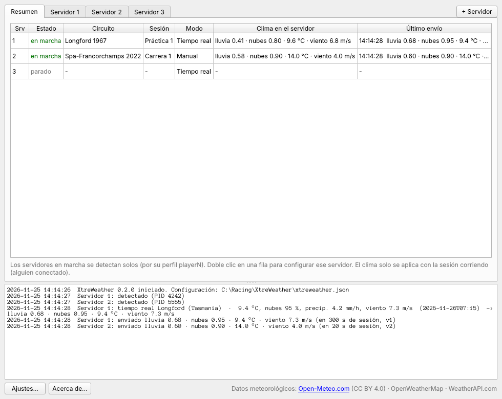
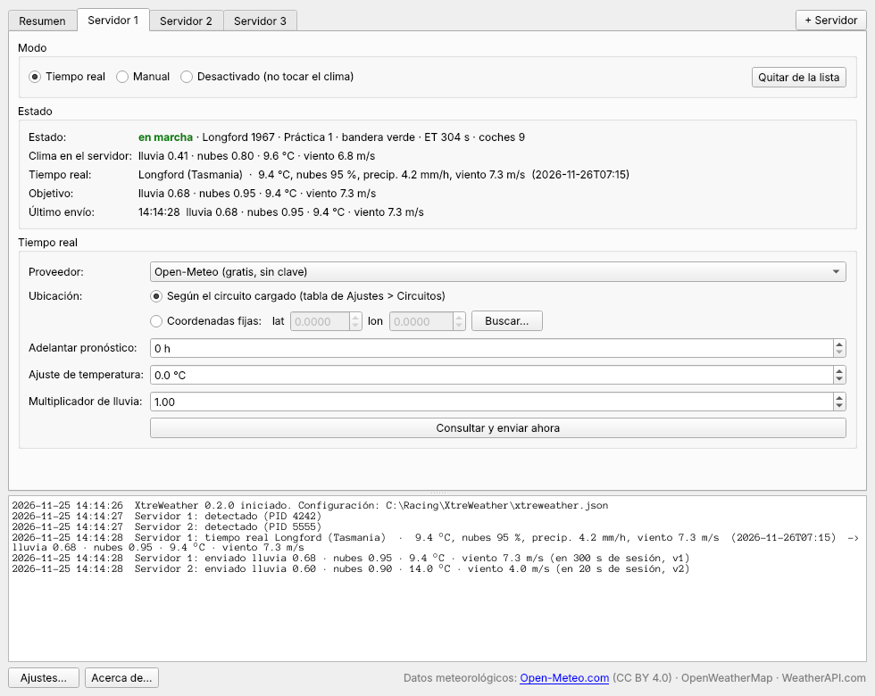
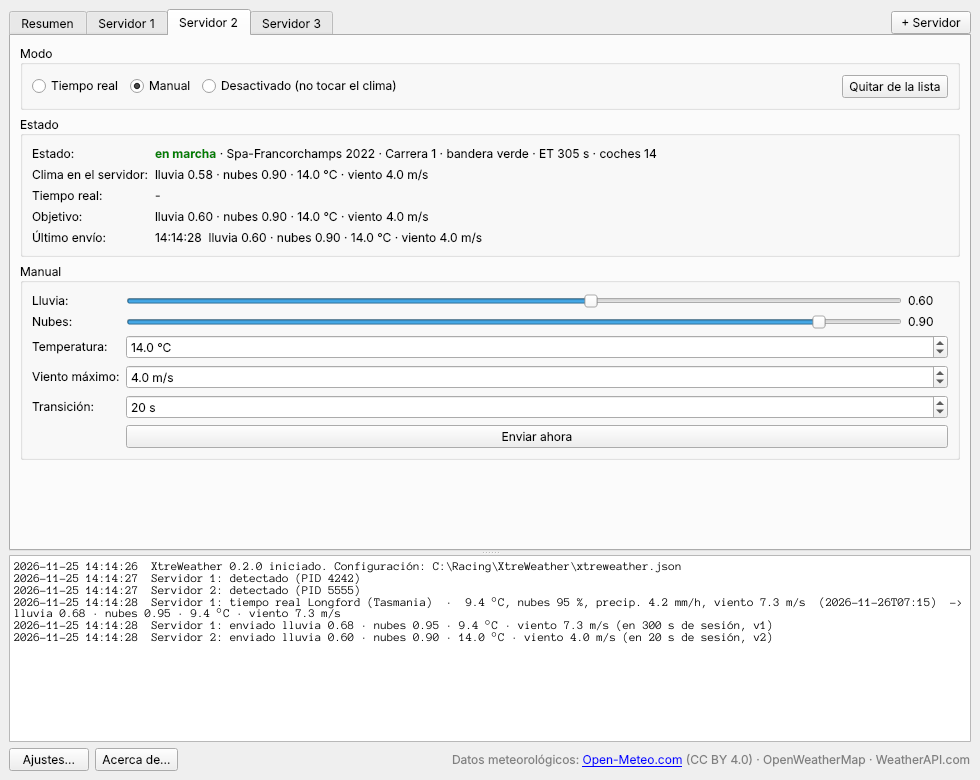
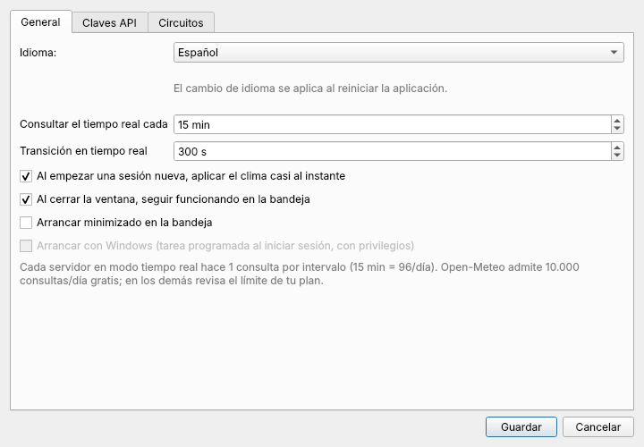
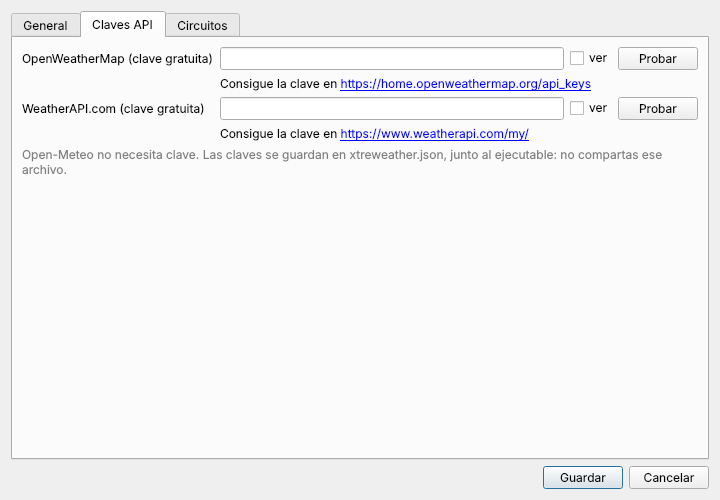
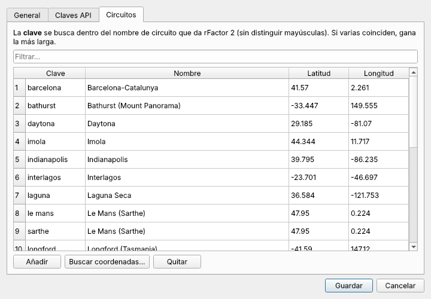

# Manual de XtreWeather

**XtreWeather** pone el clima real del circuito en tus servidores dedicados de **rFactor 2**: consulta un servicio meteorológico, convierte los datos a lluvia, nubes, temperatura y viento de rF2 y se los envía a cada servidor mientras la sesión está en marcha. También permite fijar el clima a mano.

> Proyecto creado por v1ct0r para la comunidad Xtresimracing **con asistencia de IA** (Claude, de Anthropic). Licencia GNU GPL v3.

## Índice

1. [Requisitos](#1-requisitos)
2. [Instalar el plugin de memoria compartida](#2-instalar-el-plugin-de-memoria-compartida)
3. [Instalar XtreWeather](#3-instalar-xtreweather)
4. [Ventana principal](#4-ventana-principal)
5. [Configurar un servidor](#5-configurar-un-servidor)
6. [Ajustes](#6-ajustes)
7. [Configuración recomendada](#7-configuración-recomendada)
8. [Cómo funciona](#8-cómo-funciona)
9. [Solución de problemas](#9-solución-de-problemas)
10. [Compilar desde el código](#10-compilar-desde-el-código)
11. [Créditos y licencia](#11-créditos-y-licencia)

---

## 1. Requisitos

- Windows 10/11 o Windows Server con **rFactor 2 Dedicated**.
- **rFactor2SharedMemoryMapPlugin64** (versión 3.7.15.1 o posterior) en cada servidor, con el control de clima activado (apartado 2).
- **Visual C++ 2013 Redistributable (x64)**, que necesita el plugin.
- Conexión a Internet en la máquina de los servidores (para el modo tiempo real).
- XtreWeather debe ejecutarse **en la misma sesión de Windows que los servidores** y con permisos de administrador (el .exe los pide solo).
- Para distinguir varios servidores en la misma máquina, cada uno debe arrancar con su perfil: `+profile=player1`, `+profile=player2`... Un servidor sin `+profile` cuenta como servidor 1.

## 2. Instalar el plugin de memoria compartida

1. Descarga `rf2_sm_tools` desde el enlace de la sección *Download* del repositorio oficial del plugin:
   <https://github.com/TheIronWolfModding/rF2SharedMemoryMapPlugin>
2. Copia `rFactor2SharedMemoryMapPlugin64.dll` a la carpeta `Bin64\Plugins` de tu rFactor 2 Dedicated.
3. Arranca cada servidor una vez y ciérralo: rF2 añade la entrada del plugin al archivo `UserData\playerN\CustomPluginVariables.JSON` de ese perfil.
4. Con el servidor cerrado, edita ese archivo y deja la entrada del plugin con estos valores (el resto, como estén):

   ```json
   "rFactor2SharedMemoryMapPlugin64.dll":{
     " Enabled":1,
     "EnableWeatherControlInput":1,
     "UnsubscribedBuffersMask":32
   }
   ```

   - `" Enabled"` lleva un espacio delante: es así en rF2.
   - `EnableWeatherControlInput: 1` permite enviar clima al servidor.
   - `UnsubscribedBuffersMask: 32` mantiene activos los datos de clima y de sesión. El valor de serie (160) desactiva los de clima y **XtreWeather no funcionaría**.
5. Repite el paso 4 en el perfil de cada servidor y arráncalos.

## 3. Instalar XtreWeather

1. Descarga `XtreWeather.exe` de la sección **Releases** del repositorio. No necesita instalación.
2. Déjalo en una carpeta propia, por ejemplo `C:\Racing\XtreWeather\`.
3. Ábrelo. La primera vez crea a su lado:
   - `xtreweather.json`: toda la configuración (incluidas tus claves API: **no compartas este archivo**).
   - `xtreweather.log`: el registro de actividad.

Windows Defender puede mostrar un aviso con ejecutables nuevos sin firma. El código fuente está en el repositorio si prefieres compilarlo tú (apartado 10).

## 4. Ventana principal



- **Resumen**: una fila por servidor con su estado, circuito, sesión, modo, el clima que tiene ahora el servidor y el último envío. Doble clic en una fila para abrir su pestaña.
- **Servidor N**: una pestaña por servidor. Los servidores en marcha se detectan y se añaden solos; con **+ Servidor** puedes añadir uno a mano para dejarlo configurado antes de arrancarlo.
- **Registro** (parte de abajo): todo lo que hace la aplicación. También se guarda en `xtreweather.log`.
- **Ajustes...** y **Acerca de...**: abajo a la izquierda.
- Al cerrar la ventana, la aplicación sigue funcionando en la **bandeja del sistema** (junto al reloj). Para cerrarla del todo: clic derecho en el icono > **Salir**.

## 5. Configurar un servidor

Cada pestaña tiene tres modos:

| Modo | Qué hace |
|---|---|
| **Tiempo real** | Consulta el tiempo en las coordenadas del circuito y lo envía periódicamente. |
| **Manual** | Envía el clima que fijes con los controles. |
| **Desactivado** | No toca el clima: el servidor usa su propia configuración. |

El bloque **Estado** muestra:
- **Estado**: en marcha, sesión parada, sin coordenadas, etc. (ver apartado 9), junto con el circuito, la sesión, la fase, el tiempo de sesión (ET) y los coches conectados.
- **Clima en el servidor**: lo que rF2 tiene ahora mismo.
- **Tiempo real**: los datos del proveedor (lugar, temperatura, nubes, precipitación, viento y hora).
- **Objetivo**: lo que XtreWeather quiere enviar, ya convertido a valores de rF2.
- **Último envío**: hora y valores del último envío.

### 5.1 Tiempo real



- **Proveedor**: Open-Meteo (gratis, sin clave), OpenWeatherMap o WeatherAPI (estos dos con clave gratuita, ver 6.2).
- **Ubicación**:
  - **Según el circuito cargado**: busca el nombre del circuito en la tabla de *Ajustes > Circuitos*. Si cambias de circuito, se actualiza solo.
  - **Coordenadas fijas**: usa siempre la latitud y longitud que indiques. **Buscar...** localiza un lugar por su nombre.
- **Adelantar pronóstico**: 0 = tiempo actual. Con N horas, usa el pronóstico de dentro de N horas (solo Open-Meteo). Sirve para que el evento tenga el tiempo de otra hora del día; por ejemplo, si corréis de noche en España en un circuito donde todavía no ha amanecido.
- **Ajuste de temperatura**: grados que se suman (o restan) a la temperatura real.
- **Multiplicador de lluvia**: multiplica la lluvia real antes de convertirla (ver 8.3). 0 = nunca llueve; más de 1 = la lluvia se nota más.
- **Consultar y enviar ahora**: fuerza una consulta y un envío inmediatos.

### 5.2 Manual



- **Lluvia** y **Nubes**: de 0 (seco / despejado) a 1 (diluvio / cubierto).
- **Temperatura** (°C) y **Viento máximo** (m/s).
- **Transición**: segundos de sesión hasta alcanzar el clima marcado (20 s por defecto). Las nubes cambian al instante.
- **Enviar ahora**: aplica los valores. **Mover los controles no envía nada** hasta que pulses este botón (o empiece una sesión nueva).

## 6. Ajustes

### 6.1 General



| Opción | Descripción |
|---|---|
| **Idioma** | Automático (el de Windows), Español o English. Se aplica al reiniciar. |
| **Consultar el tiempo real cada** | Intervalo entre consultas al proveedor. |
| **Transición en tiempo real** | Segundos de sesión hasta alcanzar cada clima real nuevo. |
| **Al empezar una sesión nueva, aplicar el clima casi al instante** | Al pasar de práctica a clasificación, a carrera, etc., reenvía el clima con 10 s de transición y nubes instantáneas. |
| **Al cerrar la ventana, seguir funcionando en la bandeja** | Si se desmarca, cerrar la ventana cierra la aplicación. |
| **Arrancar minimizado en la bandeja** | Abre directamente en la bandeja. |
| **Arrancar con Windows** | Crea la tarea programada *XtreWeather* que la abre al iniciar sesión, con privilegios. |

### 6.2 Claves API



Solo hacen falta si usas **OpenWeatherMap** o **WeatherAPI**:

1. Regístrate gratis en su web (los enlaces aparecen en esta pestaña) y copia tu clave.
2. Pégala en su casilla y pulsa **Probar**: debe responder con el tiempo de Madrid.
3. **Guardar**, y en la pestaña del servidor elige ese **Proveedor**.

Las claves nuevas pueden tardar un rato en activarse en el proveedor.

### 6.3 Circuitos



La tabla relaciona el nombre del circuito que da rF2 con sus coordenadas:

- **Clave**: texto que se busca dentro del nombre del circuito, sin distinguir mayúsculas. Ejemplo: la clave `longford` encaja con "Longford 1967". Si varias claves encajan, gana la más larga.
- **Nombre**: el que se mostrará en la aplicación.
- **Latitud / Longitud**: en grados decimales (sur y oeste en negativo).

Para añadir un circuito: **Añadir**, escribe la clave y el nombre, selecciona la fila y pulsa **Buscar coordenadas...** para localizar el pueblo o ciudad más cercano. El nombre exacto del circuito lo ves en la columna *Circuito* del Resumen. La aplicación trae unos 20 circuitos conocidos de serie.

## 7. Configuración recomendada

Para eventos con clasificación de unos 15 minutos y carreras de 20-30 minutos:

| Ajuste | Valor | Motivo |
|---|---|---|
| Consultar cada | **15 min** | Open-Meteo actualiza el tiempo actual aproximadamente cada 15 minutos. Son 96 consultas al día por servidor. |
| Transición en tiempo real | **300 s** | Las nubes entran antes que la lluvia y la pista se moja de forma progresiva. |
| Aplicar casi al instante al cambiar de sesión | **Activado** | Cada sesión empieza ya con el clima correcto. |
| Adelantar pronóstico | **0 h** | Tiempo real. |
| Multiplicador de lluvia | **1,0** | Súbelo a 1,5 si quieres que la llovizna se note; 0 para eventos secos. |
| Transición manual | **20 s** | El clima manual llega casi enseguida. |

Para un evento que tiene que ser seco: modo **Manual** con lluvia 0, o **Tiempo real** con multiplicador de lluvia 0 (mantiene temperatura, viento y nubes reales).

## 8. Cómo funciona

### 8.1 Envío del clima

XtreWeather escribe el clima en el buffer de control del plugin junto con un **momento objetivo** (tiempo de sesión actual + transición). rF2 va pasando del clima que tiene al nuevo hasta llegar a ese momento. Además, la pista se moja y se seca poco a poco: aunque la lluvia llegue, el agua sobre el asfalto tarda algún minuto más.

### 8.2 Sesión parada

rF2 solo procesa el clima con la **sesión en marcha**. Un servidor dedicado vacío suele tener el reloj parado: XtreWeather lo detecta (estado *sesión parada*), deja el envío **pendiente** y lo hace en cuanto entra alguien. Al cambiar de sesión (práctica → clasificación → carrera) o al reiniciar el fin de semana, vuelve a enviar el clima.

### 8.3 Conversión de datos reales

| Lluvia real | Lluvia en rF2 |
|---|---|
| Menos de 0,05 mm/h | 0 (seco) |
| 0,3 mm/h (llovizna) | 0,18 |
| 1 mm/h (débil) | 0,33 |
| 4 mm/h (moderada) | 0,67 |
| 9 mm/h o más (fuerte) | 1,00 |

- Fórmula: `lluvia = mín(1, √(mm/h × multiplicador) / 3)`. La raíz hace que la llovizna se note y la lluvia fuerte no se dispare, por eso un multiplicador de 2 no duplica la lluvia en el juego.
- Nubes = nubosidad real (%) / 100. Si llueve, como mínimo 0,6 + 0,4 × lluvia.
- Temperatura = temperatura real + ajuste. Viento = viento real a 10 m, en m/s.

### 8.4 Consumo de consultas

Cada servidor en modo tiempo real hace una consulta por intervalo, más una al cambiar de circuito o al pulsar *Consultar y enviar ahora*. Los cambios de sesión no consultan: reenvían el último dato. Con 15 minutos: 96 consultas/día por servidor. Open-Meteo admite 10.000/día gratis para uso no comercial.

## 9. Solución de problemas

| Estado o síntoma | Causa y solución |
|---|---|
| **parado** | El servidor no está en marcha o no se detecta. Comprueba que el proceso es `rFactor2 Dedicated.exe` y que XtreWeather se ejecuta en la misma sesión de Windows y como administrador. |
| **sin plugin de memoria compartida** | El plugin no está cargado: revisa el apartado 2, `" Enabled":1` y el Visual C++ 2013 x64. |
| **sin control de clima** | Falta `"EnableWeatherControlInput":1` en el perfil de ese servidor. |
| **El clima del servidor sale "-"** | `UnsubscribedBuffersMask` desactiva los datos de clima: ponlo a 32. |
| **'Circuito' sin coordenadas** | Añade el circuito en *Ajustes > Circuitos* o usa coordenadas fijas. |
| **sesión parada** | Normal con el servidor vacío. Se aplicará cuando alguien entre. |
| **esperando datos meteorológicos** | Primera consulta en curso o error del proveedor: mira el registro. |
| **clave API incorrecta** | Revisa la clave en *Ajustes > Claves API* y pulsa *Probar*. |
| **No veo cambios en pista** | Comprueba en el Resumen que el clima del servidor va acercándose al objetivo. La transición en tiempo real dura 300 s y la pista tarda en mojarse. |
| **Dos servidores salen como el mismo número** | Arranca cada uno con su `+profile=playerN`. |

Si algo no cuadra, el registro (`xtreweather.log`) indica qué se consultó, qué se envió y cuándo.

## 10. Compilar desde el código

En Windows, con Python 3.10 o posterior:

```bat
git clone <url-de-este-repositorio>
cd XtreWeather
build.bat
```

`build.bat` instala las dependencias (`requirements.txt`) y genera `XtreWeather.exe` (un solo archivo) con PyInstaller. Para ejecutarlo sin compilar: `pip install -r requirements.txt` y `python xtreweather.py`.

Estructura:
- `xtreweather.py`: interfaz (PySide6) y motor.
- `xtre_core.py`: memoria compartida, proveedores, conversión y configuración.
- `xtre_i18n.py`: textos. Para añadir un idioma, copia el bloque `"en"` y tradúcelo.

## 11. Créditos y licencia

- Creado por **v1ct0r** para la comunidad **Xtresimracing**, con asistencia de IA (**Claude**, de Anthropic).
- Licencia **GNU GPL v3** (ver `LICENSE`). Software sin garantía.
- [rF2SharedMemoryMapPlugin](https://github.com/TheIronWolfModding/rF2SharedMemoryMapPlugin) de The Iron Wolf (GPL v3).
- Datos meteorológicos: [Open-Meteo.com](https://open-meteo.com/) (CC BY 4.0), OpenWeatherMap y WeatherAPI.com.
- rFactor 2 es una marca de sus respectivos propietarios. Este proyecto no está afiliado con Studio 397 ni con Motorsport Games.
